# MEXC Trading Dashboard

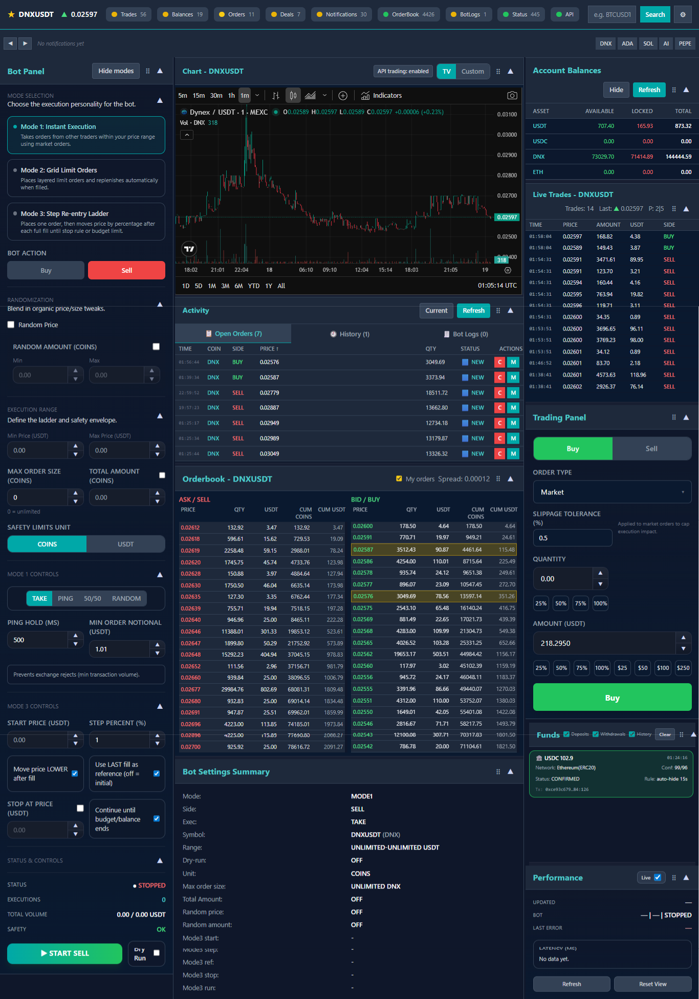

Active trading can require repeatedly moving between a chart, order book, balances, order controls and automation settings. MEXC Trading Dashboard brings those views into a configurable trading desk so the operator can inspect the market and manage activity in one place.

## Tech stack

| Layer | Technologies |
|---|---|
| Application | Python, FastAPI |
| Supporting technologies | HTML, CSS, JavaScript; MEXC; TradingView; WebSockets |

## Arrange the trading desk

Panels can be moved, resized and collapsed, and the arrangement is stored with **Save Layout** and restored with **Reset Layout**; **Snapshot UI** captures the current screen. The selected symbol and the connection state stay visible in the header, and notification preferences decide which events are announced during a session.

A trading session can involve several questions at once. Layout preferences let the operator keep the current task prominent while retaining the supporting views needed for the next decision.

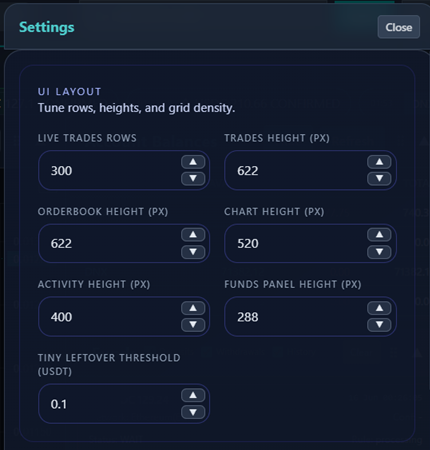

Notification preferences let the operator choose which events deserve attention during a session. They help keep useful feedback visible without requiring every event to be treated the same way.

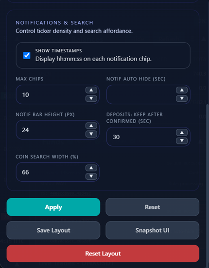

## Inspect the market

The market view combines a chart (a TradingView chart that can be switched on and off), the order book with its depth and the live trades tape. Symbol search moves between markets, and all views follow the selected symbol.

Price, depth and recent trades provide context before an order is submitted. Keep the selected symbol aligned across the available views while examining the market.

## Place and follow manual orders

The Trading Panel places buy and sell orders beside the account balances. Size shortcuts set 25, 50, 75 or 100 percent of the available funds, or a fixed 25, 50, 100 or 250 dollars, or a custom amount. Open orders, the live stream of deals and the **Funds History** tab (with deposit tracking) show what happened after an action.

Open orders and their immediate feedback make follow-up part of the same task as entry. Review the current activity before changing or replacing an existing order.

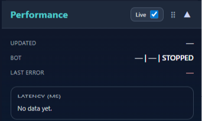

## Configure automation deliberately

The Bot Panel offers five modes: **Mode 1 Instant Execution** takes orders from other traders inside a price range with market orders (with an execution style of TAKE, PING, 50/50 or RANDOM); **Mode 2 Grid Limit Orders** places layered limit orders and replenishes them when filled; **Mode 3 Step Re-entry Ladder** places one order and moves the price by a percentage after each full fill until a stop rule or the budget is reached; **Mode 4 Front of Book** keeps one order at the best bid or ask and re-quotes one tick ahead when displaced; **Mode 5 Scheduled Exact** places one exact limit order at a set time (HH:MM:SS), optionally with a one-tick jump. Side (buy or sell), quantity in coins or in USDT, the price range, optional randomisation of price and amount and the budget are set per mode.

Mode selection changes the kind of automation being configured. Review the selected strategy, size and relevant controls together so the intended behaviour is understandable before a bot starts.

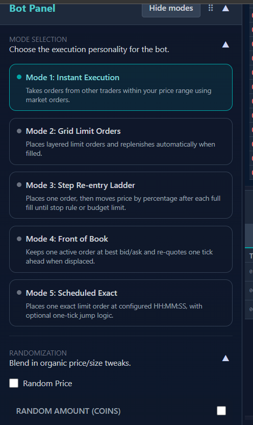

The configured action choices belong to the selected automation setup. Review their intended effect alongside the strategy rather than treating a preset as a substitute for that decision.

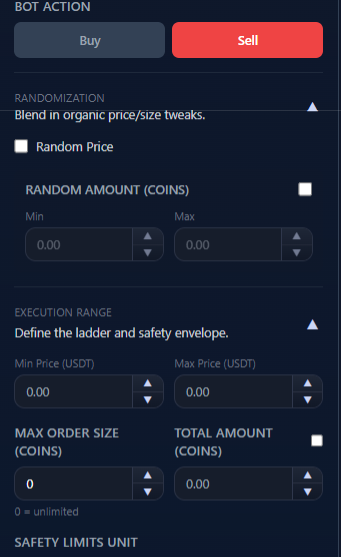

An execution range makes the intended operating conditions visible. Check it with the amount and selected mode before starting the configured activity.

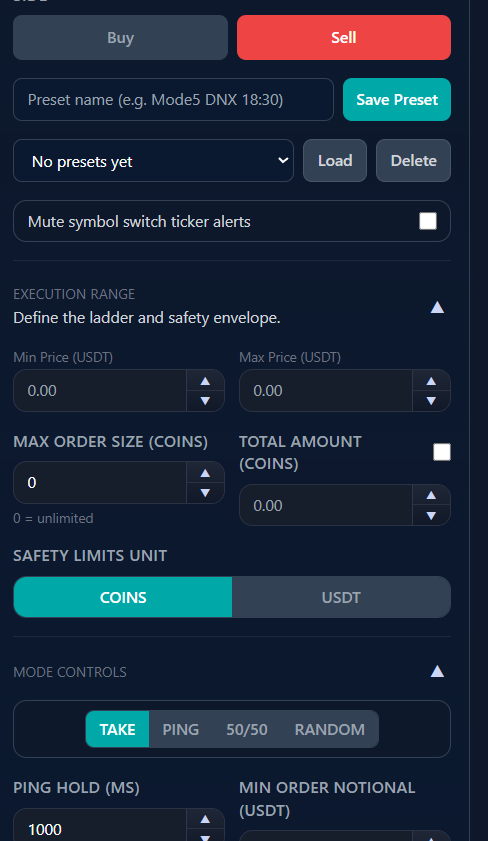

The mode status view supports following the selected automation after configuration. It keeps the current activity connected to the strategy the operator intended to run.

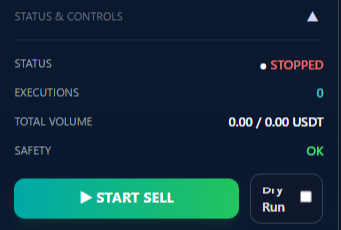

A settings summary provides a final place to review the configured automation together. It is particularly useful when returning to a saved setup after the surrounding market has changed.

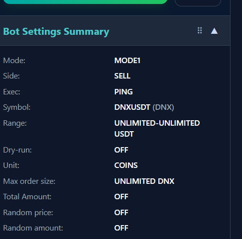

## Manage several activities

The Multi Bots workspace supports reviewing more than one configured bot context. Performance information helps examine trade and bot activity, while system statistics and debug logs assist with investigation. These tools keep operational checks close to the trading desk.

Activity and system views support monitoring more than one running task. They keep order follow-up and operating context accessible without crowding the main market view.

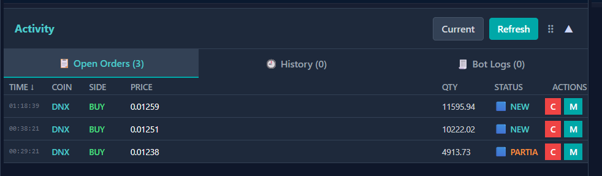

System information gives the operator context when the desk's responsiveness or activity needs attention. It supports supervision alongside the trading views.

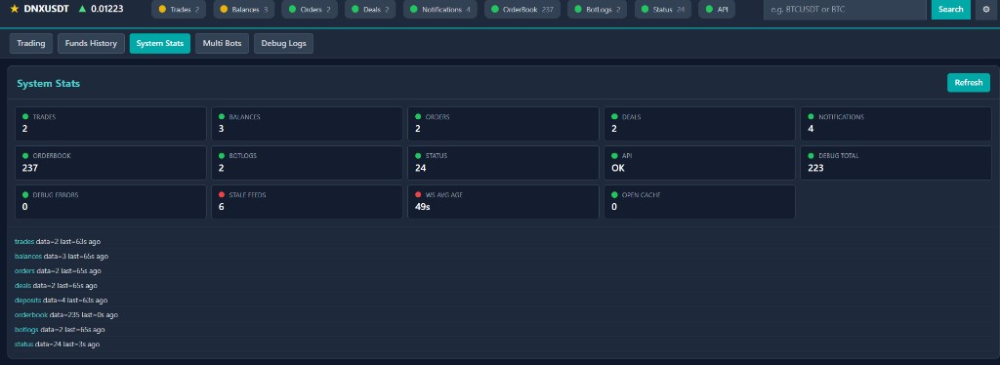

Debug logs help explain an interruption or an order event that needs closer review. They retain a focused investigation path within the workstation.

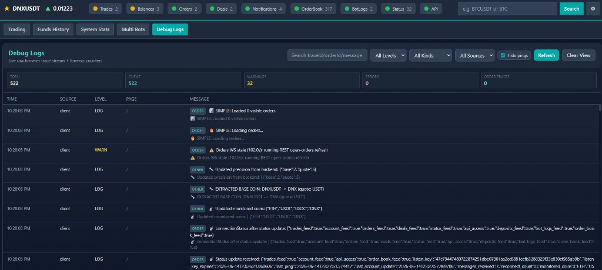

## Keep the workspace usable

Notification, search and presentation settings support different working routines. Saved layouts reduce repeated setup, and resizable views help balance detail with overview.

Presentation and diagnostics support extended use of the desk. Keep routine controls readable and use the debug views when an observed result needs a closer explanation.

---

Private code: [mexc_trading_app](https://github.com/logicencoder/mexc_trading_app)

See [REPOS.md](REPOS.md) for related repositories.

**[Logic Encoder](https://logicencoder.com)** · [GitHub](https://github.com/logicencoder) · [Contact](https://logicencoder.com/contact/)
