# MEXC Trading Dashboard

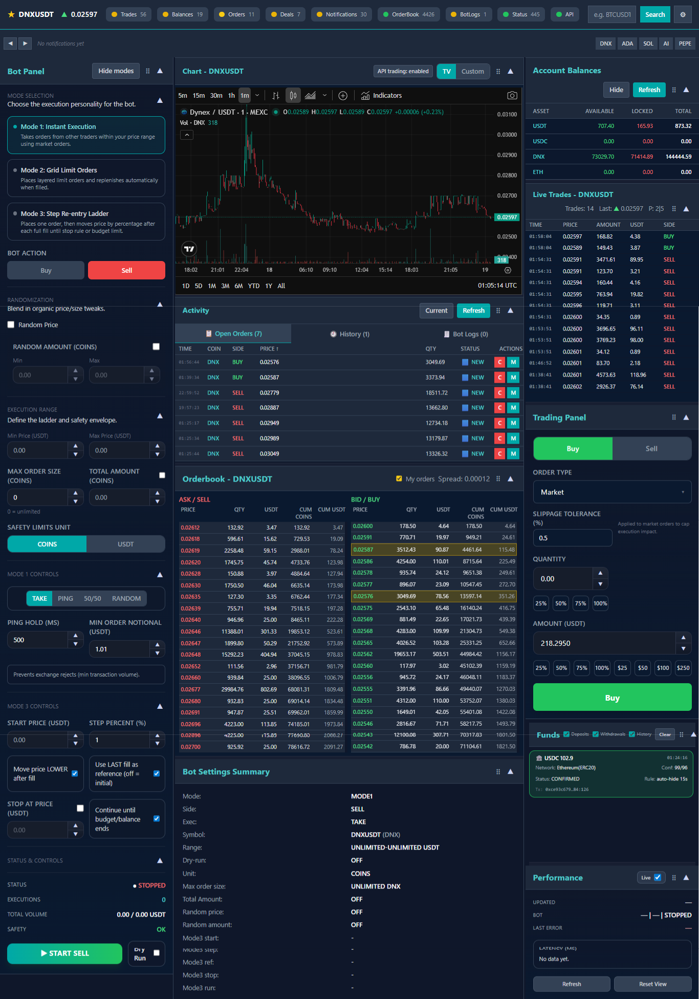

Active trading can require repeatedly moving between a chart, order book, balances, order controls and automation settings. MEXC Trading Dashboard brings those views into a configurable trading desk so the operator can inspect the market and manage activity in one place.

## Tech stack

| Layer | Technologies |
|---|---|
| Application | Python, FastAPI |
| Supporting technologies | HTML, CSS, JavaScript; MEXC; TradingView; WebSockets |

## Arrange the trading desk

Move, resize and collapse supported panels to match the work at hand. Layout preferences and display controls help keep frequently used information close together. Symbol and connection information remain visible so the operator can recognise the market and the state of the session.

A trading session can involve several questions at once. Layout preferences let the operator keep the current task prominent while retaining the supporting views needed for the next decision.

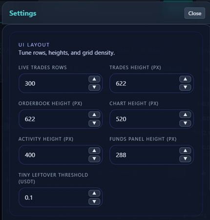

Notification preferences let the operator choose which events deserve attention during a session. They help keep useful feedback visible without requiring every event to be treated the same way.

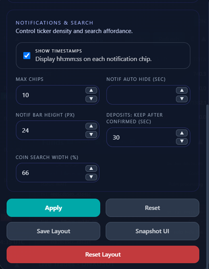

## Inspect the market

The chart, order book and live trade tape provide different views of current activity. Search and symbol controls make it easier to move between markets, while available notifications draw attention to relevant changes. These views support judgement rather than replacing it.

Price, depth and recent trades provide context before an order is submitted. Keep the selected symbol aligned across the available views while examining the market.

## Place and follow manual orders

Order entry sits beside account balances and activity panels, helping connect a proposed trade with available funds and existing orders. Open-order and recent-activity information support checking what happened after an action. Funds notifications and history add another view of account movement.

Open orders and their immediate feedback make follow-up part of the same task as entry. Review the current activity before changing or replacing an existing order.

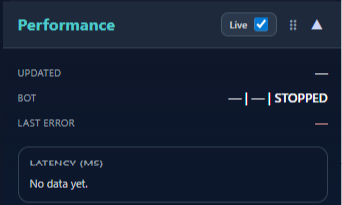

## Configure automation deliberately

Bot controls expose the supported modes, action choices and execution ranges. Mode-specific settings and a summary of the current configuration help the operator understand the selected behaviour before starting it. Status and stop controls remain part of the operating workflow.

Mode selection changes the kind of automation being configured. Review the selected strategy, size and relevant controls together so the intended behaviour is understandable before a bot starts.

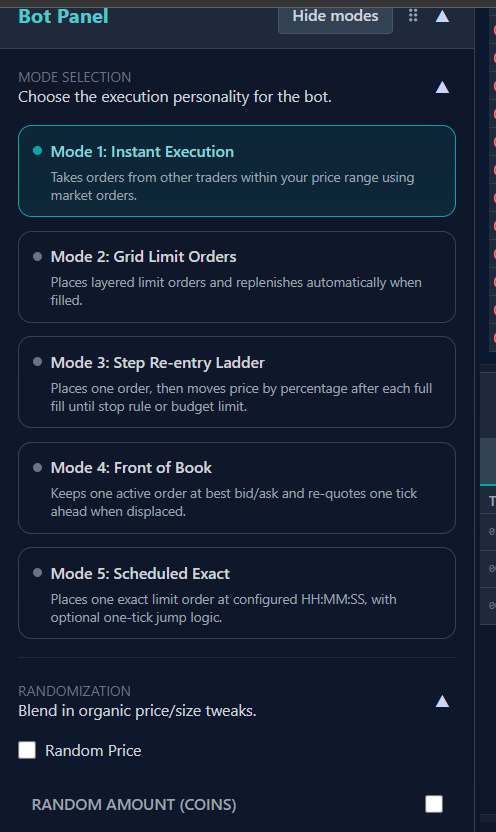

The configured action choices belong to the selected automation setup. Review their intended effect alongside the strategy rather than treating a preset as a substitute for that decision.

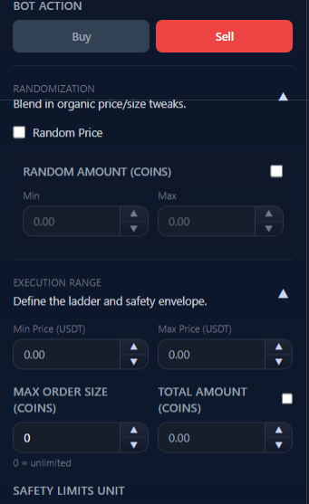

An execution range makes the intended operating conditions visible. Check it with the amount and selected mode before starting the configured activity.

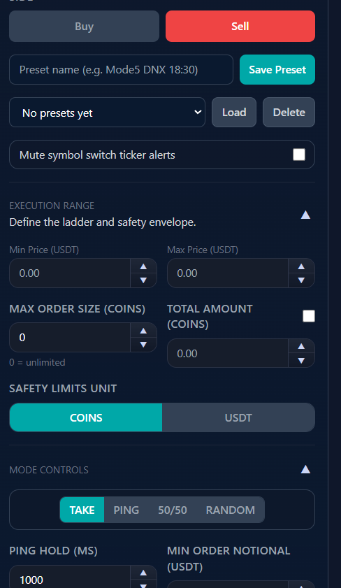

The mode status view supports following the selected automation after configuration. It keeps the current activity connected to the strategy the operator intended to run.

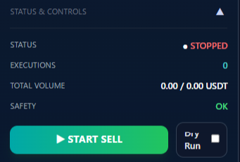

A settings summary provides a final place to review the configured automation together. It is particularly useful when returning to a saved setup after the surrounding market has changed.

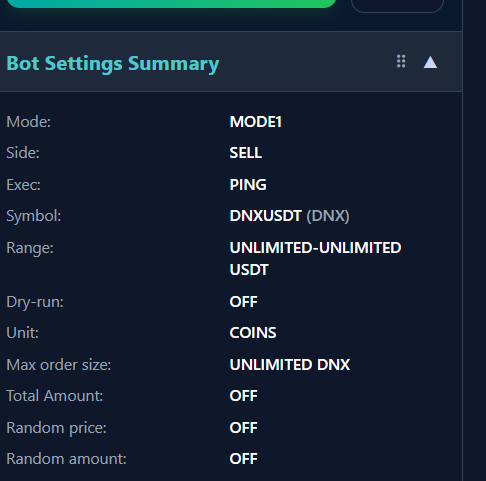

## Manage several activities

The Multi Bots workspace supports reviewing more than one configured bot context. Performance information helps examine trade and bot activity, while system statistics and debug logs assist with investigation. These tools keep operational checks close to the trading desk.

Activity and system views support monitoring more than one running task. They keep order follow-up and operating context accessible without crowding the main market view.

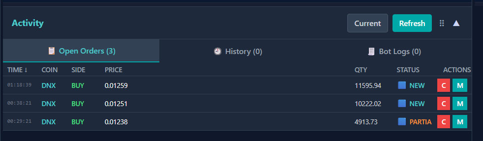

System information gives the operator context when the desk's responsiveness or activity needs attention. It supports supervision alongside the trading views.

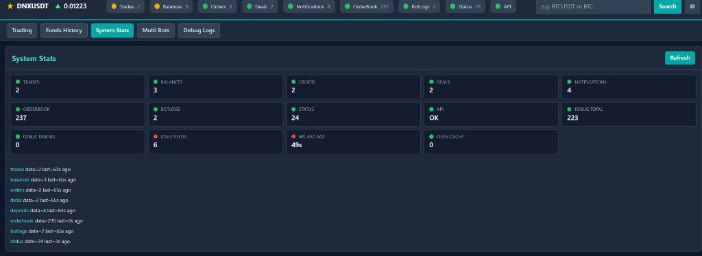

Debug logs help explain an interruption or an order event that needs closer review. They retain a focused investigation path within the workstation.

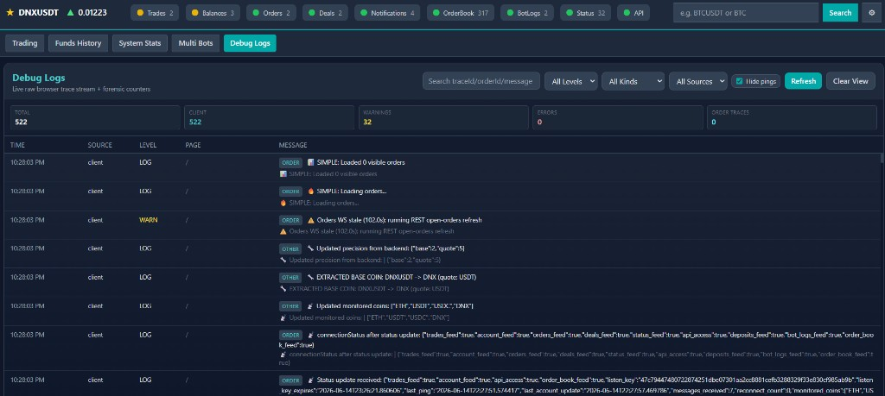

## Keep the workspace usable

Notification, search and presentation settings support different working routines. Saved layouts reduce repeated setup, and resizable views help balance detail with overview.

Presentation and diagnostics support extended use of the desk. Keep routine controls readable and use the debug views when an observed result needs a closer explanation.

---

Private code: [mexc_trading_app](https://github.com/logicencoder/mexc_trading_app)

See [REPOS.md](REPOS.md) for related repositories.

**[Logic Encoder](https://logicencoder.com)** · [GitHub](https://github.com/logicencoder) · [Contact](https://logicencoder.com/contact/)
